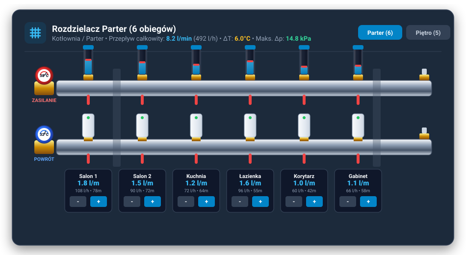
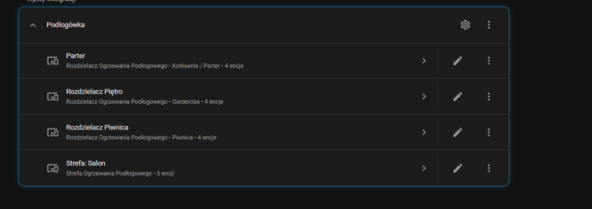

# Home Assistant: Underfloor Heating Manager 🌊🔥

> **Languages / Języki / Sprachen / Idiomas:**
> [English](#-english) | [Polski](#-polski) | [Deutsch](#-deutsch) | [Español](#-español)

  

---

## 🇬🇧 English

### Overview
**Underfloor Heating Manager** is a Home Assistant custom integration engineered for calculation, control, and hydraulic balancing of hydronic radiant floor heating systems.

  

### What's New in v1.1.0:
- **Streamlined Setup (Manifold $\rightarrow$ Loops)**: Add a heating manifold (e.g. Ground Floor, 8 loops) and immediately configure loops by selecting one or multiple loops simultaneously.
- **Batch Assignment**: Assign room name, floor area ($m^2$), rotameter flow rate in **$l/min$**, screed type (cement, anhydrite, dry system), and screed thickness ($mm$) in a single step.
- **Interactive Manifold Visualization Card (RWD)**: Realistic hydraulic manifold representation featuring stainless steel supply bar with vertical rotameters and moving floats, return bar with actuators, inlet/outlet ball valves with thermometers, and direct $l/min$ stepper controls.

### Key Features
1. **Manifold Management**: Configure heating manifolds, monitor aggregate volume flow ($l/min$ and $l/h$), and assess loop pressure drops.
2. **Room & Screed Dynamics**: Define room areas ($m^2$), screed composition and thickness ($mm$). Computes floor thermal mass, resistance, and thermal inertia (hours).
3. **Loop Length Auto-Estimation**: Automatically calculates PE pipe circuit lengths based on room area, number of loops, pipe spacing (e.g. 10, 15, 20 cm), and manifold transit distance.
4. **Rotameters as Native HA Entities**: Direct reading and slider adjustments for flow rates ($l/min$ and $l/h$) through `number.*` entities, ready for dashboards and automations.
5. **Hydraulic Diagnostics**: Calculates flow velocity ($m/s$) and pressure drops ($\Delta p$ in $kPa$) using Darcy-Weisbach equations. Detects throttled, oversized, or excessively long loops (> 100 m for 16x2 pipes).
6. **Responsive Lovelace Card (RWD)**: Realistic manifold visualization matching physical manifolds with manifold switching tabs (Ground Floor / First Floor).

### Installation via Home Assistant

#### Option 1: HACS (Recommended)
1. Open **HACS** in your Home Assistant interface.
2. Click the top-right **three dots menu** and select **Custom repositories**.
3. Paste your repository URL: `https://github.com/underface/ha-underfloor-heating`
4. Select Category: **Integration**.
5. Click **Add**, locate **Underfloor Heating Manager** in the list, and select **Download**.
6. Restart Home Assistant.
7. Navigate to **Settings** $\rightarrow$ **Devices & Services** $\rightarrow$ **Add Integration**, search for **Underfloor Heating**, and follow the wizard.

#### Option 2: Manual Installation
1. Download the `ha-underfloor-heating.zip` release archive.
2. Copy the `custom_components/underfloor_heating` directory into your Home Assistant server's `/config/custom_components/` directory.
3. Restart Home Assistant.
4. Go to **Settings** $\rightarrow$ **Devices & Services** $\rightarrow$ **Add Integration** and select **Underfloor Heating**.

---

## 🇵🇱 Polski

### Opis wtyczki
**Zarządzanie Ogrzewaniem Podłogowym** to zaawansowana integracja dla Home Assistant służąca do parametryzacji, estymacji, regulacji oraz hydraulicznej diagnostyki wodnego ogrzewania podłogowego.

  

### Nowości w wersji 1.1.0:
- **Błyskawiczna konfiguracja (Rozdzielacz $\rightarrow$ Pętle)**: Dodajesz rozdzielacz (np. Parter, 8 pętli), a pętle są generowane natychmiast.
- **Grupowe przypisywanie pętli**: Zaznaczasz 1 lub wiele pętli naraz i w jednym kroku określasz: pomieszczenie, łączny metraż ($m^2$), nastawę rotametrów w **$l/min$** oraz rodzaj i grubość posadzki/jastrychu ($mm$).
- **Fotorealistyczna wizualizacja rozdzielacza (Karta Lovelace RWD)**: Prawdziwy widok rozdzielacza hydraulicznego: stalowa belka zasilająca z pionowymi rotametrami, skalą w $l/min$ i pływakami, belka powrotna z siłownikami, zawory kulowe z termometrami (35°C / 30°C) oraz przyciski regulacji przepływu `[-]` `[+]` co 0.1 l/min.

### Główne funkcje
1. **Zarządzanie rozdzielaczami**: Obsługa wielu rozdzielaczy, sumaryczny przepływ objętościowy ($l/min$ i $l/h$) oraz maksymalne straty ciśnienia na obiegach.
2. **Strefy i właściwości wylewki**: Parametryzacja powierzchni ($m^2$), rodzaju wylewki (anhydrytowa, cementowa, sucha) oraz jej grubości ($mm$). Wyliczanie masy posadzki, oporu cieplnego i bezwładności termicznej (h).
3. **Automatyczna estymacja długości pętli**: Wyliczanie długości obiegów rur PE na podstawie metrażu, liczby pętli, rozstawu (10, 15, 20 cm) oraz odległości do rozdzielacza.
4. **Rotametry jako encje w HA**: Odczyt i nastawy przepływu ($l/min$ i $l/h$) poprzez dedykowane encje `number.*` dostępne dla pulpitów i automatyzacji.
5. **Diagnostyka hydrauliczna**: Obliczanie prędkości przepływu ($m/s$) i strat ciśnienia ($\Delta p$ w $kPa$) równaniem Darcy-Weisbacha. Automatyczne wykrywanie obiegów zdławionych, przewymiarowanych oraz pętli za długich (> 100 m dla rury 16x2).
6. **Responsywna karta Lovelace (RWD)**: Gotowy widok belki rozdzielacza z możliwością przełączania kondygnacji (Parter / Piętro).

### Instalacja przez serwer Home Assistant

#### Sposób 1: Przez HACS (Rekomendowany)
1. Otwórz **HACS** w menu Home Assistant.
2. W prawym górnym rogu kliknij menu **trzy kropki** i wybierz **Niestandardowe repozytoria** (*Custom repositories*).
3. Wklej adres URL repozytorium: `https://github.com/underface/ha-underfloor-heating`
4. Wybierz kategorię: **Integracja** (*Integration*).
5. Kliknij **Dodaj** (*Add*), znajdź **Zarządzanie Ogrzewaniem Podłogowym** na liście i kliknij **Pobierz** (*Download*).
6. Zrestartuj Home Assistant.
7. Wejdź w **Ustawienia** $\rightarrow$ **Urządzenia i usługi** $\rightarrow$ **Dodaj integrację**, wyszukaj **Zarządzanie Ogrzewaniem Podłogowym** i skonfiguruj instalację.

#### Sposób 2: Instalacja ręczna
1. Pobierz archiwum `ha-underfloor-heating.zip`.
2. Skopiuj katalog `custom_components/underfloor_heating` do folderu `/config/custom_components/` na swoim serwerze Home Assistant.
3. Zrestartuj Home Assistant.
4. Przejdź do **Ustawienia** $\rightarrow$ **Urządzenia i usługi** $\rightarrow$ **Dodaj integrację** i wybierz wtyczkę z listy.

---

## 🇩🇪 Deutsch

### Übersicht
**Fußbodenheizungs-Manager** ist eine benutzerdefinierte Home Assistant-Integration zur Berechnung, Steuerung und hydraulischen Optimierung wassergeführter Fußbodenheizungssysteme.

### Neuerungen in Version 1.1.0:
- **Optimierte Einrichtung (Verteiler $\rightarrow$ Heizkreise)**: Verteiler anlegen (z. B. Erdgeschoss, 8 Kreise) – die Heizkreise werden sofort automatisch generiert.
- **Gruppenzuweisung**: Wählen Sie einen oder mehrere Kreise gleichzeitig aus und definieren Sie Raum, Fläche ($m^2$), Durchfluss in **$l/min$**, Estrichart und Dicke ($mm$) in einem Schritt.
- **Realistische Verteiler-Visualisierung (Lovelace RWD)**: Komplette grafische Darstellung des Heizkreisverteilers: Edelstahl-Vorlaufbalken mit vertikalen Durchflussmessern und beweglichen Schwimmern, Rücklaufbalken mit Stellantrieben, Kugelhähne mit Thermometern und Tasten zur Durchflusseinstellung (`+/- 0.1 l/min`).

### Hauptfunktionen
1. **Verteiler-Verwaltung**: Konfiguration von Heizkreisverteilern, Erfassung des Gesamtdurchflusses ($l/min$ und $l/h$) sowie des maximalen Druckverlusts.
2. **Heizzonen & Estrich-Dynamik**: Definition von Raumflächen ($m^2$), Estrichart (Anhydrit, Zement, Trockenbau) und Estrichdicke ($mm$). Berechnung von thermischer Masse, Wärmedurchgangswiderstand und thermischer Trägheit (Stunden).
3. **Automatische Heizkreislängen-Schätzung**: Exakte Berechnung der Rohrlängen basierend auf Raumgröße, Heizkreisanzahl, Verlegeabstand (10, 15, 20 cm) und Anbindeleitung zum Verteiler.
4. **Durchflussmesser als native HA-Entitäten**: Direktes Einstellen und Auslesen der Soll-Durchflüsse ($l/min$ und $l/h$) über `number.*`-Entitäten für Dashboards und Automatisierungen.
5. **Hydraulische Fehlerdiagnose**: Berechnung von Strömungsgeschwindigkeit ($m/s$) und Druckabfall ($\Delta p$ in $kPa$) nach Darcy-Weisbach. Erkennt hydraulisch unterversorgte, überdimensionierte oder zu lange Heizkreise (> 100 m bei 16x2 Rohr).
6. **Responsive Lovelace-Karte (RWD)**: Realitätsnahe Benutzeroberfläche mit Verteiler-Umschaltung (Erdgeschoss / Obergeschoss).

### Installation über Home Assistant

#### Option 1: HACS (Empfohlen)
1. Öffnen Sie **HACS** in Home Assistant.
2. Klicken Sie oben rechts auf das **Drei-Punkte-Menü** und wählen Sie **Benutzerdefinierte Repositories**.
3. Fügen Sie die Repository-URL ein: `https://github.com/underface/ha-underfloor-heating`
4. Wählen Sie als Kategorie: **Integration**.
5. Klicken Sie auf **Hinzufügen**, suchen Sie nach **Fußbodenheizungs-Manager** und wählen Sie **Herunterladen**.
6. Starten Sie Home Assistant neu.
7. Navigieren Sie zu **Einstellungen** $\rightarrow$ **Geräte & Dienste** $\rightarrow$ **Integration hinzufügen**, suchen Sie nach **Fußbodenheizung** und schließen Sie die Einrichtung ab.

#### Option 2: Manuelle Installation
1. Laden Sie das Archiv `ha-underfloor-heating.zip` herunter.
2. Kopieren Sie den Ordner `custom_components/underfloor_heating` in das Verzeichnis `/config/custom_components/` Ihres Home Assistant-Servers.
3. Starten Sie Home Assistant neu.
4. Gehen Sie zu **Einstellungen** $\rightarrow$ **Geräte & Dienste** $\rightarrow$ **Integration hinzufügen** und wählen Sie die Integration aus.

---

## 🇪🇸 Español

### Descripción general
**Gestor de Suelo Radiante** es una integración personalizada para Home Assistant diseñada para el cálculo, control y equilibrado hidráulico de sistemas de calefacción por suelo radiante por agua.

### Novedades en la versión 1.1.0:
- **Configuración rápida (Colector $\rightarrow$ Circuitos)**: Añada un colector (ej. Planta baja, 8 circuitos) y los circuitos se generan de inmediato.
- **Asignación múltiple**: Seleccione uno o varios circuitos a la vez y defina estancia, superficie ($m^2$), caudal en **$l/min$**, tipo de recrecido y espesor ($mm$) en un solo paso.
- **Visualización gráfica del colector (Lovelace RWD)**: Representación visual completa del colector: barra de impulsión de acero con caudalímetros verticales y flotadores móviles, barra de retorno con actuadores, válvulas con termómetros y botones de regulación rápida (`+/- 0.1 l/min`).

### Características principales
1. **Gestión de colectores**: Control de colectores de distribución, monitorización del caudal volumétrico total ($l/min$ y $l/h$) y pérdidas de carga máximas.
2. **Zonas y propiedades del recrecido**: Configuración de superficie ($m^2$), tipo de recrecido (anhidrita, cemento, solera seca) y espesor ($mm$). Cálculo de masa térmica, resistencia térmica e inercia térmica de la estancia (horas).
3. **Estimación automática de longitud de circuitos**: Cálculo automático de metros de tubería PE según superficie, circuitos, paso de tubos (10, 15, 20 cm) y distancia de conexión al colector.
4. **Caudalímetros como entidades nativas de HA**: Lectura y ajuste directo de los caudales ($l/min$ y $l/h$) mediante entidades `number.*`, preparadas para tarjetas y automatizaciones.
5. **Diagnóstico hidráulico**: Estimación de velocidad del fluido ($m/s$) y pérdidas de presión ($\Delta p$ en $kPa$) mediante la formulación de Darcy-Weisbach. Detección automática de circuitos estrangulados, sobredimensionados o con longitud excesiva (> 100 m para tubo 16x2).
6. **Tarjeta Lovelace adaptable (RWD)**: Interfaz visual de colector con selector entre plantas (Planta baja / Planta alta).

### Instalación en el servidor Home Assistant

#### Opción 1: Mediante HACS (Recomendado)
1. Abra **HACS** en la interfaz de Home Assistant.
2. Haga clic en el **menú de tres puntos** (arriba a la derecha) y seleccione **Repositorios personalizados** (*Custom repositories*).
3. Introduzca la URL de su repositorio: `https://github.com/underface/ha-underfloor-heating`
4. Seleccione la categoría: **Integración** (*Integration*).
5. Haga clic en **Añadir**, busque **Gestor de Suelo Radiante** en la lista y presione **Descargar**.
6. Reinicie Home Assistant.
7. Vaya a **Ajustes** $\rightarrow$ **Dispositivos y servicios** $\rightarrow$ **Añadir integración**, busque **Suelo Radiante** y siga el asistente.

#### Opción 2: Instalación manual
1. Descargue el archivo `ha-underfloor-heating.zip`.
2. Copie la carpeta `custom_components/underfloor_heating` dentro del directorio `/config/custom_components/` de su servidor Home Assistant.
3. Reinicie Home Assistant.
4. Vaya a **Ajustes** $\rightarrow$ **Dispositivos y servicios** $\rightarrow$ **Añadir integración** y seleccione la integración.
