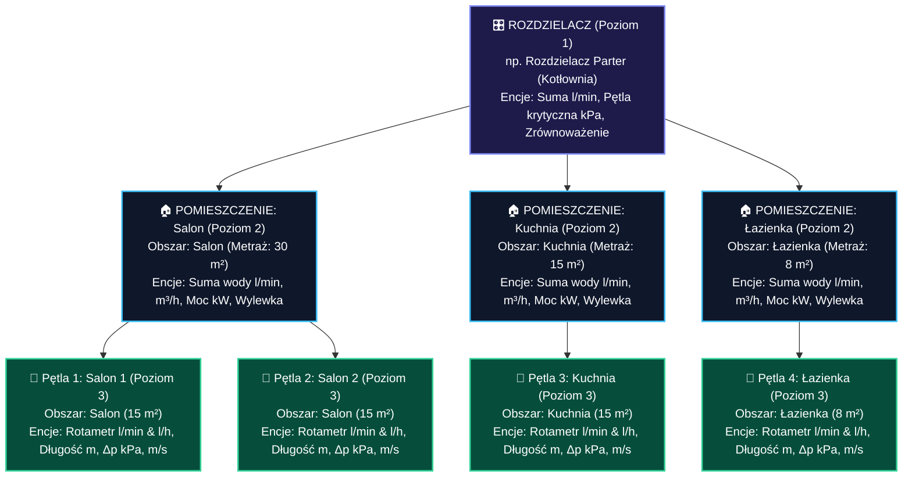
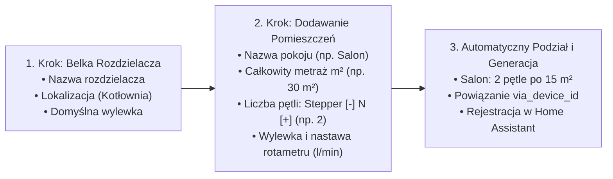

# Home Assistant: Zarządzanie Ogrzewaniem Podłogowym (Underfloor Heating Manager) 🌊🔥

[](https://github.com/hacs/default)
[](https://github.com/underface/ha-underfloor-heating/releases)
[](https://opensource.org/licenses/MIT)

> **Języki / Languages / Sprachen / Idiomas:**  
> [🇵🇱 Polski](#-polski) | [🇬🇧 English](#-english) | [🇩🇪 Deutsch](#-deutsch) | [🇪🇸 Español](#-español)

---

## 🇵🇱 Polski

### Opis integracji
**Zarządzanie Ogrzewaniem Podłogowym** to zaawansowana integracja dla Home Assistant zaprojektowana z myślą o instalacjach podłogowych z **manualnymi rotametrami** i tradycyjnymi rozdzielaczami. 

Integracja nie wymaga drogich przepływomierzy IoT. Użytkownik wprowadza jedynie nastawę ze szklanej rurki rotametru ($l/min$ lub $l/h$), a wbudowany silnik inżynieryjny w czasie rzeczywistym samoczynnie oblicza:
- Dokładną długość pętli ($m$) na podstawie metrażu i rozstawu rur,
- Rzeczywisty liniowy i miejscowy spadek ciśnienia $\Delta p$ ($kPa$) wg wzoru Darcy-Weisbacha i Colebrooka-White'a,
- Prędkość przepływu cieczy ($m/s$) z ostrzeżeniem o ryzyku zapowietrzenia (< 0.15 m/s) lub szumach (> 0.8 m/s),
- Sumaryczny przepływ wody dla całego pokoju ($l/min$, $l/h$, $m^3/h$) oraz oddawaną moc cieplną ($kW$),
- Właściwości termiczne wylewki (cementowa, anhydrytowa, sucha) oraz bezwładność cieplną ($h$).

---

### Ścisła 3-poziomowa Hierarchia Urządzeń (Device Registry)

Integracja buduje w Home Assistant pełną, relacyjną hierarchię urządzeń opartą o `via_device_id`:



---

### Nowy Model Konfiguracji 100% Room-First (v1.4.0)

W v1.4.0 całkowicie usunięto sztywne określanie liczby sekcji przy tworzeniu rozdzielacza. Konfiguracja rozpoczyna się od pomieszczeń:



---

### Dedykowany Panel Boczny ("Podłogówka") w Menu Home Assistant

Integracja automatycznie dodaje pozycję **"Podłogówka"** (ikona `mdi:heating-coil`) w lewym menu nawigacyjnym Home Assistant:
- **Zero konfiguracji YAML**: Nie musisz tworzyć kart ani edytować plików konfiguracyjnych.
- **Wbudowany formularz**: Górny pasek zapełnienia (10 gniazd belki, licznik zajętych pętli, łączna powierzchnia $m^2$, suma przepływów $l/min$).
- **Karty pomieszczeń**: Zmiana metrażu, dodawanie/usuwanie pętli stepperem `[-]` `N` `[+]`, regulacja rotametrów `[-]` `1.5 l/min` `[+]`.
- **Szybkie dodawanie**: Gotowe szablony pokoi: `+ WC` ($4\ m^2$), `+ Łazienka` ($9\ m^2$), `+ Sypialnia` ($14\ m^2$), `+ Korytarz` ($8\ m^2$).
- **Żywy podgląd rozdzielacza**: Wizualizacja stalowych belek Inox AISI 304, pływaków rotametrów i siłowników elektrotermicznych NC.

---

### Wizualny Schemat Belki Rozdzielacza (RWD)

```
========================================================================================
                      ROZDZIELACZ HYDRAULICZNY - PODŁOGÓWKA
 Przepływ sumaryczny: 7.2 l/min (432 l/h) | Zasilanie/Powrót: 38°C / 32°C (ΔT=6.0°C) | Δp_max: 15.7 kPa
========================================================================================

 [ZASILANIE 38°C] ===[ BELKA GÓRNA INOX AISI 304 - ZASILAJĄCA (FLOW) ]===================
                        |             |             |             |             |
                       [1]           [2]           [3]           [4]           [5]
                     Rotametr      Rotametr      Rotametr      Rotametr      Rotametr
                    (1.8 l/m)     (1.5 l/m)     (1.5 l/m)     (1.4 l/m)     (1.0 l/m)
                        |             |             |             |             |
                        |             |             |             |             |
 [POWRÓT 32°C]   ===[ BELKA DOLNA INOX AISI 304 - POWROTNA (RETURN) ]===================
                        |             |             |             |             |
                     Siłownik      Siłownik      Siłownik      Siłownik      Siłownik
                     230V NC       230V NC       230V NC       230V NC       230V NC
                        |             |             |             |             |
                     Pętla #1      Pętla #2      Pętla #3      Pętla #4      Pętla #5
                    Sypialnia      Pokój Dzieci  Pokój Dzieci   Łazienka      Pralnia
                    (14.0 m²)     (10.0 m²)     (10.0 m²)     (8.0 m²)      (6.0 m²)
========================================================================================
```

---

### Instrukcja Instalacji

#### Sposób 1: Przez HACS (Rekomendowany)
1. Otwórz **HACS** w menu Home Assistant.
2. Kliknij ikonę **trzech kropek** w prawym górnym rogu i wybierz **Niestandardowe repozytoria** (*Custom repositories*).
3. Wklej URL repozytorium: `https://github.com/underface/ha-underfloor-heating`
4. Wybierz kategorię: **Integracja** (*Integration*).
5. Kliknij **Dodaj** (*Add*), odszukaj **Zarządzanie Ogrzewaniem Podłogowym** i kliknij **Pobierz** (*Download*).
6. Zrestartuj Home Assistant.
7. Przejdź do: **Ustawienia** $\rightarrow$ **Urządzenia i usługi** $\rightarrow$ **Dodaj integrację**, wpisz **Zarządzanie Ogrzewaniem Podłogowym** i skonfiguruj swoje pomieszczenia.

#### Sposób 2: Instalacja ręczna
1. Pobierz archiwum `ha-underfloor-heating.zip` z sekcji Releases.
2. Rozpakuj zawartość do folderu `/config/custom_components/underfloor_heating/` na serwerze Home Assistant.
3. Zrestartuj Home Assistant.
4. Przejdź do **Ustawienia** $\rightarrow$ **Urządzenia i usługi** $\rightarrow$ **Dodaj integrację** i wybierz wtyczkę.

---

### Dostępne Usługi (Services)

| Nazwa usługi | Opis | Główne parametry |
| :--- | :--- | :--- |
| `underfloor_heating.save_manifold_configuration` | Zapisuje całą konfigurację pomieszczeń i pętli z panelu/karty Lovelace | `manifold_id`, `rooms` (tablica obiektów) |
| `underfloor_heating.set_rotameter_flow` | Zmienia nastawę rotametru dla wybranej pętli | `loop_id`, `rotameter_flow_lh` |
| `underfloor_heating.update_zone` | Aktualizuje parametry termiczne pokoju (metraż, wylewka, grubość) | `zone_id`, `area_m2`, `screed_type`, `screed_thickness_mm` |
| `underfloor_heating.update_loop` | Aktualizuje parametry hydrauliczne pojedynczej pętli | `loop_id`, `spacing_cm`, `approach_length_m`, `pipe_type` |

---

## 🇬🇧 English

### Overview
**Underfloor Heating Manager** is a specialized Home Assistant integration designed for hydronic underfloor heating manifolds equipped with **manual mechanical rotameters**.

No expensive IoT smart valves required. You simply set or read your rotameter glass indicator value ($l/min$ or $l/h$), and the integration's physical engine calculates:
- Exact PE pipe loop length ($m$) based on room area, loop count, and pipe spacing,
- Realistic linear and localized pressure drop $\Delta p$ ($kPa$) using Darcy-Weisbach and Colebrook-White formulas,
- Fluid velocity ($m/s$) with automated warnings for low velocity (< 0.15 m/s airlock risk) or excessive velocity (> 0.8 m/s noise risk),
- Aggregate room flow rates ($l/min$, $l/h$, $m^3/h$) and actual thermal power output ($kW$),
- Screed thermal storage and response time inertia (hours) for cement, anhydrite, and dry systems.

### 3-Level Device Registry Hierarchy
- **Level 1 (Manifold)**: Central manifold device (total volume flow, critical loop $\Delta p$, balance state).
- **Level 2 (Rooms / Zones)**: Linked via `via_device_id` to Manifold. Contains aggregate flow, area ($m^2$), screed properties, and thermal inertia ($h$).
- **Level 3 (Heating Loops)**: Linked via `via_device_id` to Room. Contains manual rotameter number entities ($l/min$ and $l/h$) and physical sensors (loop length, $\Delta p$, flow velocity, balance status).

### Dedicated Sidebar Panel ("Podłogówka")
Registered automatically in Home Assistant's left navigation menu (`underfloor-heating-panel.js`):
- Full-screen configuration modal matching the manifold layout,
- Stepper controls `[-]` `N` `[+]` for room loops and rotameters,
- Instant sync via service `underfloor_heating.save_manifold_configuration`.

---

## 🇩🇪 Deutsch

### Übersicht
**Fußbodenheizungs-Manager** ist eine Home Assistant Integration für wassergeführte Fußbodenheizungsverteiler mit **manuellen Durchflussmessern (Tacosettern / Rotametern)**.

Die Integration erfordert keine teuren IoT-Sensoren. Sie stellen einfach den abgelesenen Wert des Schauglases ($l/min$ oder $l/h$) ein, und die physikalische Berechnungslogik ermittelt in Echtzeit:
- Exakte Rohrlänge ($m$) aus Raumfläche, Kreisanzahl und Verlegeabstand,
- Druckverlust $\Delta p$ ($kPa$) nach Darcy-Weisbach und Colebrook-White,
- Fließgeschwindigkeit ($m/s$) mit Warnung bei Entlüftungsrisiko (< 0.15 m/s) oder Strömungsgeräuschen (> 0.8 m/s),
- Raum-Gesamtdurchfluss ($l/min$, $l/h$, $m^3/h$) und Heizleistung ($kW$),
- Estrich-Eigenschaften und thermische Trägheit (Stunden).

### 3-Stufige Gerätehierarchie
- **Ebene 1 (Verteiler)**: Hauptgerät für den Heizkreisverteiler.
- **Ebene 2 (Räume / Zonen)**: Zugeordnet über `via_device_id` zum Verteiler.
- **Ebene 3 (Heizkreise)**: Zugeordnet über `via_device_id` zum jeweiligen Raum.

---

## 🇪🇸 Español

### Descripción general
**Gestor de Suelo Radiante** es una integración para Home Assistant orientada a colectores de suelo radiante con **caudalímetros (rotámetros) manuales**.

No precisa sensores inteligentes por circuito. El usuario introduce el valor visual del caudalímetro ($l/min$ o $l/h$) y el motor de cálculo obtiene automáticamente:
- Longitud real del circuito ($m$) según superficie, número de tubos y separación,
- Pérdida de carga $\Delta p$ ($kPa$) mediante formulación Darcy-Weisbach y Colebrook-White,
- Velocidad del fluido ($m/s$) con alertas por baja velocidad (< 0.15 m/s) o ruido (> 0.8 m/s),
- Caudal total por estancia ($l/min$, $l/h$, $m^3/h$) y potencia térmica suministrada ($kW$),
- Inercia térmica del recrecido (horas) para mortero de cemento, anhidrita y solera seca.

### Jerarquía en 3 niveles
- **Nivel 1 (Colector)**: Equipo principal en el registro de dispositivos.
- **Nivel 2 (Estancias / Zonas)**: Vinculado mediante `via_device_id` al colector.
- **Nivel 3 (Circuitos de calefacción)**: Vinculado mediante `via_device_id` a la estancia.
